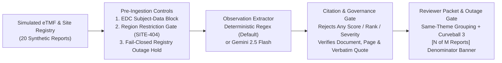

# Clinical Monitoring Report Triage Prototype (`caldera-monitoring-triage`)

**Pre-GxP Clinical Monitoring Observation Surfacing Prototype with Mandatory Citation Schemas & Denominator-Aware Outage Degradation**

---

## 1. What Problem It Solves

Clinical trial study managers reviewing multi-page site monitoring visit reports (MVRs) face cognitive overload when identifying recurring operational themes (such as Informed Consent, Temperature Monitoring, or Drug Accountability findings) across visits—especially when upstream eTMF or site-registry services experience partial outages or return incomplete documents.

This prototype demonstrates a **bounded observation-surfacing architecture**:
- **Surfacing, Not Predicting ([`ADR-001`](docs/governance/decisions/ADR-001-surfacing-vs-predictive.md)):** Deliberately scoped as a **pre-GxP cognitive working aid** *outside* the 21 CFR Part 11 / GxP system-of-record boundary. Schema validators explicitly reject predictive risk scores, rankings, or automated regulatory deviation verdicts.
- **Verbatim Citation Enforcement (`SourceCitation`):** Every surfaced candidate observation requires `document_id`, `page_number`, and `verbatim_sentence` fields verified against the source report page.
- **Resilience Under Operational Curveballs:** Enforces EDC subject-data rejection, EU/regional boundary routing ([`ADR-002`](docs/governance/decisions/ADR-002-region-restriction-boundary.md)), zero-page report exclusion logging, and **Curveball 3 denominator-aware partial-outage disclosure** (`[N of M reports analyzed]`).

---

## 2. Team Context & My Specific Contribution

This repository was created during a **Team 2 (`FDE Pod 2`) Forward Deployed Engineering build sprint**.

- **Team 2 Shared Baseline (`FDE Pod 2`):** Initial Python reference models, simulated eTMF/site-registry clients, and ISO/IEC 42001 governance documentation (`docs/governance/`).
- **My Specific Contributions (`Surya`):**
  1. **TypeScript / React / Express Interactive Web Application (`server.ts`, `src/App.tsx`, `src/server/pipeline.ts`):** Integrated the full-stack interactive web workbench alongside the Python reference pipeline.
  2. **Curveball 3 — Partial eTMF 500 Denominator Disclosure:** Engineered the partial-outage degradation gate across both Python (`src/pipeline/triage_graph.py`) and TypeScript (`src/server/pipeline.ts`), forcing system status to `DEGRADED` and displaying explicit retrieved-vs-expected denominators (`total_reports_processed / total_reports_expected`) whenever upstream eTMF batch retrieval fails mid-flight.
  3. **Architecture & Curveballs Presentation Decks:** Authored [`docs/Caldera_FDE_Factored_by_Design_Presentation.pptx`](docs/Caldera_FDE_Factored_by_Design_Presentation.pptx) and [`docs/curveball_presentation_deck.html`](docs/curveball_presentation_deck.html).

---

## 3. Current Capabilities and Status

**Maturity Status:** **Public FDE Sprint Prototype (Dual Python + TypeScript/React Implementation · Synthetic Dataset · Non-GxP)**

### Verified Repository Structure

```text
caldera-monitoring-triage/
├── server.ts                                 # Express API server (/api/triage, /api/governance-tests)
├── package.json                              # Node.js / React 18.3 / Vite / TypeScript configuration
├── requirements.txt                          # Python reference pipeline & pytest dependencies
├── pytest.ini                                # Pytest configuration
├── data/
│   └── sample_reports/
│       └── twenty_reports.json               # 20 synthetic clinical monitoring visit reports (with edge cases)
├── src/
│   ├── App.tsx                               # Interactive React clinical reviewer & Curveball simulation UI
│   ├── main.tsx                              # React frontend entrypoint
│   ├── types.ts                              # TypeScript domain interfaces
│   ├── server/
│   │   └── pipeline.ts                       # TypeScript triage pipeline, regex/Gemini extractors & citation verifier
│   ├── models.py                             # Pydantic v2 domain models with EDC, non-predictive & citation validators
│   ├── clients/
│   │   ├── ai_studio_client.py               # Optional Google AI Studio (gemini-2.5-flash) client with citation verification
│   │   ├── etmf_client.py                    # Simulated eTMF client with Curveball 3 HTTP 500 outage simulation
│   │   └── site_registry.py                  # Site metadata & regional boundary lookup
│   └── pipeline/
│       ├── extractor.py                      # Deterministic regex observation extractor + Gemini fallback
│       └── triage_graph.py                   # Python triage orchestration pipeline with citation gate
├── scripts/
│   └── verify_ts_controls.ts                 # TypeScript citation grounding & immutability regression tests (8 assertions)
├── tests/
│   ├── test_controls.py                      # 7 unit tests for EDC boundary, regional routing, non-predictive schema & citation validation
│   ├── test_curveball_degradation.py         # 3 unit tests for Curveball 3 partial eTMF 500 denominator disclosure
│   └── test_pipeline_slice.py                # End-to-end Python pipeline slice test
└── docs/
    ├── FDE_SPRINT_STORY_AND_WALKTHROUGH.md
    ├── DEMO_PRESENTATION_SCRIPT.md
    ├── FDE_CURVEBALLS_BY_DESIGN_DECK.md
    ├── curveball_presentation_deck.html
    └── governance/                           # ADR-001, ADR-002, threat-model.md, risk-register.md, iso42001-mapping.md
```

---

## 4. Quick Start

### A. Run the Interactive TypeScript / React Web Application
```bash
npm install
npm run lint
npx tsx scripts/verify_ts_controls.ts
npm run build
npm run dev
# Open http://localhost:3000
```
- Without `GEMINI_API_KEY`, the application runs in **deterministic offline regex extraction mode** across all 20 synthetic reports.
- To enable optional live Gemini (`gemini-2.5-flash`) extraction, copy `.env.example` to `.env` and set `GEMINI_API_KEY`.

### B. Run the Python Reference Pipeline & Automated Tests
```bash
python3 -m venv .venv && source .venv/bin/activate
pip install -r requirements.txt
pytest tests/ -v --tb=short
```

---

## 5. Architecture and Key Decisions



---

## 6. Tests and Evaluation Evidence

Both implementations are verified in [`.github/workflows/ci.yml`](.github/workflows/ci.yml):
1. **Python `pytest` Suite (`11 passed in 0.08s`):**
   - [`tests/test_controls.py`](tests/test_controls.py) (7 tests): Verifies pre-extraction regional restriction drop (`SITE-404`, `RESTRICTED_REGION_X`), EDC subject-level data rejection (`enforce_edc_boundary`), forbidden predictive field rejection (`check_forbidden_fields`), verbatim citation provenance, unconfigured AI Studio fallback, and **citation validation regression checks** (rejecting fabricated/paraphrased quotes, whitespace quotes, wrong `page_number` attribution, wrong `document_id` attribution, and enforcing `SourceCitation` immutability).
   - [`tests/test_curveball_degradation.py`](tests/test_curveball_degradation.py) (3 tests): Verifies full eTMF HTTP 500 fail-safe, Site Registry HTTP 500 fail-closed staging hold, and partial eTMF HTTP 500 outage (`11 of 20 reports` retrieved, `system_status == "DEGRADED"`, and `SITE-101` `3 of 6 reports` denominator disclosure).
   - [`tests/test_pipeline_slice.py`](tests/test_pipeline_slice.py) (1 test): End-to-end 20-report corpus verification (`4` restricted exclusions for `SITE-404`, `3` eligible sites processed).
2. **TypeScript Typecheck, Citation Regression Suite & Production Build:**
   - `npm run lint` (`tsc --noEmit` — `0` errors).
   - `npx tsx scripts/verify_ts_controls.ts` (**`8/8 assertions passed`** covering verbatim quote acceptance, fabricated quote rejection, wrong page/document attribution rejection, `Object.freeze` citation immutability, and pipeline filtering).
   - `npm run build` (`vite build` + `esbuild server.ts` — builds `dist/index.html`, `dist/assets/`, and `dist/server.cjs`; emits 1 non-blocking esbuild CJS warning for `import.meta.url` in `server.ts:16`).

---

## 7. Known Limitations

- **Not GxP-Validated:** By explicit architectural design ([`ADR-001`](docs/governance/decisions/ADR-001-surfacing-vs-predictive.md)), this prototype is an unvalidated cognitive surfacing aid and must not be used as a clinical system of record.
- **Synthetic Data Only:** Operates on 20 synthetic monitoring reports in `data/sample_reports/twenty_reports.json`; `etmf_client.py` and `site_registry.py` are in-memory simulators.
- **In-Memory Exclusion Log:** `ExclusionRecord` and `SourceCitation` use frozen Pydantic models (`ConfigDict(frozen=True)`) during pipeline execution, but results are returned in-memory/JSON rather than persisted to an external WORM database.
